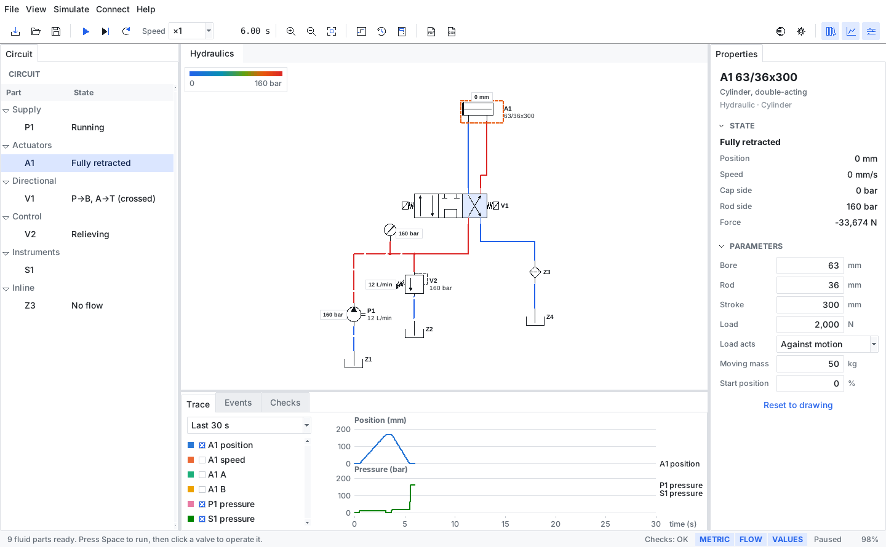

# FluidWorx

<p align="center">
  
</p>

**Free and open-source hydraulic and pneumatic circuit simulator.** Import a circuit you drew in
[OpenSchematix](https://github.com/nrobertson152/OpenSchematix), press play, and operate it.
Windows and Linux. Version 0.1.0.

Copyright © 2026 Nate Robertson.
Licensed under the GNU General Public License v3.0 or later (see `LICENSE`).

FluidWorx is for technicians, engineers, students and hobbyists who want to see how a circuit behaves before
building it. It works fully offline and has no accounts, telemetry, advertisements or feature limits. If you find it
useful you can optionally [support development on Ko-fi](https://ko-fi.com/nr270343).



## Features

- **Opens OpenSchematix circuits as they are.** `.schematix` projects and `.osch` drawings, using OpenSchematix's own
  symbols and connectivity, so nothing is redrawn and lines through sheet connectors stay connected.
- **A live drawing.** Wires coloured by pressure, flow moving along the real paths, valves that shift, rods that move,
  and values right on the drawing.
- **Operate it with the mouse.** Click either side of a valve to work its operator. Start and stop pumps, close shut-off
  valves and adjust flow controls while it runs.
- **Reads your numbers.** `160 bar`, `10 L/min` and `63/36x300` on the drawing become the simulation's values. Change
  any of them in the Properties panel; the schematic is never touched.
- **Trace, events and checks.** Plot positions, speeds and pressures, read what happened and when, and see what
  FluidWorx noticed about the circuit, including anything it can't simulate.
- **Metric or US customary**, with OpenSchematix's six themes. It starts in your OpenSchematix theme.
- **Reports.** A self-contained HTML report with a picture of the circuit, plus trace and event CSV.

## Works with the family

| Program | What FluidWorx does with it |
|---|---|
| **OpenSchematix** | *Tools ▸ Simulate in FluidWorx* there opens the saved project here. *Connect ▸ Edit schematic* here opens your drawing. Save it there and FluidWorx offers to reload, keeping your values. |
| **RevisionWorx** | Shows which revision you're simulating, by comparing content hashes, and warns if the file matches none. Registers, checks out and checks in studies through RevisionWorx's own command line, next to the schematic's project. RevisionWorx recognizes `.fluidworx` files by content. |
| **Caldera** | *Send calculations to Caldera* writes a `.caldera` project with each cylinder as a saved calculation, noting the simulated stroke times. *Use values from a Caldera project* applies saved sizes to the selected part. |

None of them is needed to run FluidWorx. It finds them on your `PATH`, or set their locations in *Preferences*.

## Installing

**From source (any OS):** Python 3.10 or newer with Tkinter (Debian/Ubuntu: `sudo apt install python3-tk`). There are no
other dependencies.

```
git clone https://github.com/nrobertson152/FluidWorx
cd FluidWorx
python -m fluidworx [circuit.schematix | drawing.osch | study.fluidworx]
```

To check that a copy works: `python -m fluidworx --self-test`. To see what would be simulated without opening a window:
`python -m fluidworx --check circuit.schematix`.

**Packages:** each push builds a Windows installer and portable zip, and a Linux AppImage and tar.gz, under the
*Build packages* workflow on GitHub Actions. To build them yourself, use `packaging/build_windows.bat`, or
`packaging/build_linux.sh` and `packaging/build_appimage.sh`.

## Quick start

1. **Open a circuit.** *File ▸ Import OpenSchematix circuit*, or try one from *File ▸ Open example*.
2. **Press Space** to run. The pump starts and pressure appears on the lines.
3. **Click the left or right side of a valve** to operate it. Click again to release.
4. **Click any part** to read it and change its values in the *Properties* panel. Pressing Enter applies a value now,
   while it runs. Inputs accept math like `30/2`, or their own unit like `160 bar`.
5. **Save a study** (`Ctrl+S`) to keep your values with a copy of the schematic.

Blue lines are at tank pressure; red lines are at the highest setting in the circuit. The key is in the corner of the
drawing, and hovering over a line shows its pressure and flow.

## Files

| Extension | Contents |
|---|---|
| `.fluidworx` | Study: your values, plus a copy of the schematic (ZIP + JSON, see [`docs/FILE_FORMAT.md`](docs/FILE_FORMAT.md)) |
| `.schematix`, `.osch` | OpenSchematix circuits. Read only: FluidWorx never changes them |

Your settings are in `%APPDATA%\FluidWorx` (Windows) or `~/.config/fluidworx` (Linux).

## Limitations (please read)

FluidWorx shows how a circuit behaves: what shifts, what moves, in what order and at about what speed. **Its model is
deliberately simple, it isn't a sizing tool, and it doesn't show that a circuit is safe.** Always have safety-related
designs reviewed by a qualified person. In particular:

- Flow is linear with pressure drop, lines have no length, and air is treated as a compressible liquid, so pressures
  and speeds are indicative.
- Electrical sheets aren't simulated. You operate solenoids by clicking the valve. Limit switches, pressure switches,
  cams and rollers don't drive anything yet.
- Intensifiers, servo positioners and custom symbols aren't simulated; their ports are blocked and the Checks panel
  says so.
- Only tested on Linux so far. CI is set up for Windows, but native Windows use hasn't been checked by hand.

[`docs/MODEL.md`](docs/MODEL.md) has the full model and what each part does.

## Development

See [`AGENTS.md`](AGENTS.md) for the rules and commands. The simulation core has no GUI dependency:

```python
from fluidworx import circuit, engine

project, warnings = circuit.load_project("lift.schematix")
c = circuit.build(project, warnings)
sim = engine.Simulator(c)
valve = next(k for k, b in sim.parts.items() if b.part.kind == "dcv")
sim.command(valve, "left")
sim.run(5.0)
print(sim.actuators()[0].x)   # metres
```

`fluidworx/vendor/openschematix` is an unmodified copy of the parts of OpenSchematix that read and draw circuits;
refresh it with `tools/sync_openschematix.py`.
