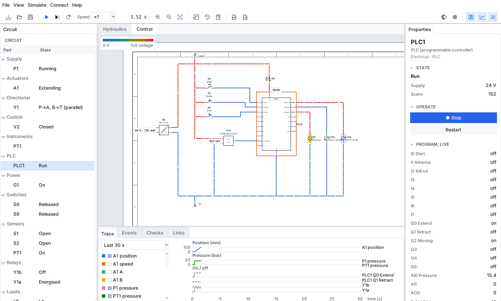

# Electrical, electronic and PLC simulation

The electrical sheets of a drawing run in the same simulation as its fluid sheets. A push-button closes, a PLC scans, an
output energises a coil, a valve shifts, a rod moves, a limit switch makes, and the PLC sees it. There's nothing to set
up: open the drawing and press play.

This is for logic first. **What switches, in what order and why is meant to be right.** Voltages, currents and times are
good enough to check a design by hand (does the coil pull in, what does the supply carry, does the fuse hold), and
no better. See [What it doesn't do](#what-it-doesnt-do).

Try it: *File ▸ Open example ▸ PLC running a cylinder*, press Space, and hold the mouse down on **S0** on the Control sheet.

## How the two sides are tied together

**The same tag means the same device.** That is how a drawing is already read, so most drawings need nothing more.

| On the electrical sheet | On the fluid sheet | What happens |
|---|---|---|
| Coil `Y1` | Valve `Y1` with one solenoid | The coil operates it |
| Coils `Y1a`, `Y1b` | Valve `Y1` with two solenoids | `a` is the left-hand solenoid, `b` the right-hand one |
| Coil `Y4` | Proportional valve `Y4` | Its voltage sets the opening: 10 V is fully open, unless the coil has its own rating |
| Contact `S3` | Pressure switch `S3` | The contact follows the switch |
| Analog sensor `PT1` | Gauge or transducer `PT1` | The sensor reads that pressure |
| Motor `M1` | Pump `M1` | The pump runs while the motor does, and the motor draws what the pump is doing |
| Contact `K1` | (coil `K1`, electrical) | The contact follows the coil |
| Contact `F1` | (overload `F1`, electrical) | The contact changes when the overload trips |

A few things a tag can't say are ordinary component properties, which you can set in OpenSchematix's *Simulation* section:

| Property | On | Example |
|---|---|---|
| `Senses` | Position switch, sensor, potentiometer | `A1 100%`, `A1 extended`, `A1 0%`, `A1 retracted`, `A1 150 mm`, `A1 > 50%`, `A1 > 150 mm`, `PT1 > 120 bar`, `M1 > 500 rpm` |
| `Senses` | Analog sensor or potentiometer | `A1` or `PT1`: its whole range follows that actuator or pressure |
| `Solenoid a`, `Solenoid b` | Valve | The tag of the coil, if it isn't the valve's own |
| `Driven by` | Pump | The tag of the motor, if it isn't the pump's own |
| `Senses` | Valve with a roller, plunger or cam | The same places as a position switch. `Senses a` and `Senses b` if it has one on each side |

The **Links** tab lists everything that was found. The **Checks** tab lists what looks as though it should have been tied to
something and wasn't. To try a link without changing the drawing, set it in the Properties panel: it's kept in the study
and the schematic is left alone. An analog sensor's range comes from its label (`0-250 bar 0-10 V`) or its parameters.

A valve with a coil can still be clicked, as a manual override. A valve without one works by clicking, as it always has.

A relay's contacts all share its tag, however many there are. OpenSchematix's *Check drawing* tells identical symbols with one tag
apart by their terminal numbers, so give each its own (`13-14`, `23-24`). The simulation goes by the tag alone.

## What makes a line live

- **A source.** A battery, an AC source, a power supply, a transformer's secondary or a rectifier's output.
- **A label, if nothing real feeds that circuit.** A control circuit is often drawn with its supply left out: label the lines
  `+24V` and `0V` (or `L`, `N`, `L1`, `L2`, `L3`, `VCC`, `GND`) with a supply-rail symbol, a connection point or a sheet
  connector, and those lines are live. A label never overrides what's really connected.
- **Supply lines with the same name are one line**, wherever they're drawn. A `+24V` rail at the head of each rung is one
  line, carries one current and loses power all at once. `+24V` and `24 VDC` are the same line. This is the one place
  FluidWorx joins more than OpenSchematix's netlist does; other labels join only through sheet connectors, as they do there.
- All earth symbols are one node. A circuit with no earth takes the negative of its supply as 0 V, so isolated circuits stay
  isolated.
- A power supply with nothing connected to its input is simply on. Connect its input and it needs it.

## Operating it

- **Hold the mouse down on a push-button** to press it. The Properties panel can latch it, to keep it held.
- **Click a switch, selector, E-stop or breaker** to operate it. A contact with nothing to follow can be clicked too.
- A position switch or proximity sensor with no `Senses` can be clicked as if something had reached it.
- An analog sensor with no link has a slider in Properties. So does a potentiometer.
- Wires are coloured from blue at 0 V to red at the full voltage of their own circuit, with beads for current. A closed contact
  has a line through it. One drawn closed that has opened shows a gap and a raised red blade. Energised coils, lit lamps and
  running motors are highlighted, and a PLC shows RUN or STOP and a light on each pin.

## The PLC

The PLC is an ordinary electrical part: its pins are terminals and its wires are wires. Programming it is covered in
OpenSchematix's `docs/PLC.md`. In FluidWorx:

- It runs from the supply on `L+` and `M`. It starts cold when that reaches 75% of its rated supply, and stops with its outputs
  off below 60%. Reversed, it's off. With nothing wired there, it doesn't run, and the Checks tab says so.
- **Each scan:** inputs are read from the voltages at the last step, the programs run in their listed order, outputs are written.
  The scan time is the program's own, and timers keep real time whatever it is.
- **Inputs** are 3.3 kΩ to `M`. On at 15 V and off at 5 V on a 24 V supply, holding in between. So a switch to +24 V or a PNP sensor is
  the straightforward wiring; an NPN sensor needs a pull-up, and reads inverted. **Analog inputs** are 100 kΩ, or 250 Ω for a current signal. **Outputs** switch `L+` to the pin (sourcing), the pin to `M` (sinking), or `C` to the pin (relay).
  **Analog outputs** are 1 Ω voltage sources or current sources.
- A fault, such as a division by zero or an endless loop, stops the PLC and drops its outputs, and the reason is in the Events tab.
  Properties has **Stop/Run** and **Restart**, and the live value of every input, output and variable.
- **The Program tab shows it running.** Ladder rungs are lit as far as the power really went in the last scan, so a contact past an open one is dark however its input
  stands. A timer shows its elapsed time and a counter its count. Function blocks are lit by the signals on their wires, and charts by their active steps. Structured text, C and
  Python have nothing to light: the text is there, with the variables alongside. It's read-only: edit a program in OpenSchematix.
- A program with errors doesn't run. The errors are in the Checks tab.

## What's modelled

| Part | Model |
|---|---|
| Source | A voltage behind 20 mΩ, folding back to its current limit if it has one |
| Power supply | The same, with 90% efficiency reflected to its input. Off below its minimum input |
| Rectifier | DC out = factor × AC in (0.9 by default); it only sources |
| Regulator | Holds its voltage, input current equal to output current. Below its dropout, input less dropout |
| Transformer, autotransformer | Ideal ratio with a little winding resistance. Carries RMS values and phasors alike |
| Resistor, capacitor, inductor | As you'd expect, in 10 ms backward-Euler steps |
| Diode, LED, zener | A voltage then a resistance, in each direction it conducts |
| Bipolar transistor | Cut off, active (Ic = hFE × Ib) or saturated |
| MOSFET, JFET | A switch with an on-resistance, set by its gate-source voltage. No body diode |
| Thyristor, triac | Fires on gate current, then conducts until below its holding current |
| Op-amp | High gain, limited 1.5 V below V+ and 0.1 V above V−, or its set swing with no supply pins drawn |
| Logic gates, flip-flops | Ideal, with no delay, and no supply pins. High is the circuit's own voltage, or its regulator's |
| Coil | A resistance from its voltage and power. Pulls in at 75%, lets go at 40% |
| Timer relay | The same, with its contacts delayed |
| Contact | 10 mΩ closed, open otherwise |
| Fuse | Heat as (I/In)² seconds: blows at 10 of it, which is about 10× in 0.1 s and 2× in 3 s |
| Breaker | The same at 30, about 2× in 10 s, and at once from 5× |
| Thermal overload | Changes its contacts: about 7× in 8 s and 2× in 2 minutes. It never opens the power circuit itself |
| Motor | A resistance from its voltage and power. Runs from 70% of its voltage. Driving a pump, its power is flow × pressure ÷ 0.85, and at least a tenth of its rating |
| Three-phase motor | The same, as three windings in star. It won't start on two phases; running, it carries on, with √3 the current, until an overload acts. Swap two phases and it reverses |
| Lamp, sounder | A resistance from its voltage and power |
| Proximity sensor | Three wires, output tied to + (PNP) or − (NPN). Needs its supply |
| Analog sensor | Voltage or current out in proportion to what it reads. Three wires, or two for 4-20 mA with about 9 V needed across it |

A part's rating of 0 means "the voltage of the circuit it's in". So a coil with no rating on a 230 V circuit is a 230 V coil, and one
marked `24 V` on a 12 V circuit doesn't pull in, as it wouldn't in real life.

**Races have one answer, and say so.** Relays change one at a time, the first in drawing order winning, with the voltages worked out
again between each. So in an interlock, the first relay drawn wins, every time. A real machine has no drawing order, so when relays are
ready to change at the same moment and another order would leave them differently, the Events tab says *K1 and K2 raced*, a message
appears, the status bar counts it, and the report lists it. The order is tried for real, on the relays and logic, with no effect on the
run. A relay that only blips in one order, with nothing to show for it afterwards, isn't reported. It looks at what the relays do to each
other at that moment, so a race that only shows through the fluid side, such as a valve shifting in time, isn't found. So no warning
doesn't prove there's no race.

Logic parts all change together on one solution, which is what lets two flip-flops on one clock shift by one place: they count as much
faster than relays. A relay changes at most once a 10 ms step, so one that interrupts itself buzzes, and the Events tab says it's
chattering. Logic that oscillates carries on and says so.

## Reading values from the drawing

| On the drawing | Sets |
|---|---|
| Label or `rating`: `24 V`, `230 VAC` | Source, supply, rail or rated voltage |
| Label or `rating`: `4 W`, `3 kW` | Power of a coil, lamp or motor |
| Label or `rating`: `5 A` | Fuse or breaker rating, overload setting, or a supply's current limit |
| Label: `4k7`, `220R`, `1M`, `10 kΩ` | Resistance |
| Label: `100 uF`, `10 mH` | Capacitance, inductance |
| Label: `5 s`, `500 ms` | Delay of a timer relay |
| Label: `230/24 V` | Transformer primary and secondary |
| Label: `7805` | Regulator voltage |
| Label: `0-250 bar`, `0-300 mm`, `4-20 mA`, `0-10 V` | Analog sensor range and output |

## Failing a part on purpose

To see what the rest of the machine does when something goes wrong, right-click a part and choose **What if it fails**, or use the same
list in Properties. It takes effect at once, with the machine running or paused.

| Part | What can go wrong |
|---|---|
| Contact, switch, push-button, limit switch | Stuck open, stuck closed (welded) |
| Coil, relay, solenoid | Burnt out, short circuit, stuck pulled in, won't pull in |
| Proximity sensor | Output stuck off or on |
| Analog sensor | Signal lost (0 V or 0 mA), reads full scale, stuck at this reading |
| Fuse, breaker | Blown or failed open, won't trip |
| Overload | Tripped, won't trip |
| Motor | Burnt out, short circuit, seized (six times its rating in current), or one winding open on three-phase |
| PLC | CPU stopped, an output stuck on or off, an input stuck on or off, an analog input reading zero |
| Lamp, sounder | Burnt out, short circuit |
| Supply, regulator, rectifier, transformer | No output |
| Resistor, capacitor, inductor, diode, transistor | Open, short |
| Valve | Spool stuck where it is |
| Relief, sequence, reducing, unloading, check, flow control | Stuck closed, stuck open |
| Pump | No output |
| Cylinder, motor | Seized, seal leaking |
| Accumulator | Lost its gas |
| Pressure switch | Stuck off or on |

**Right-click a line** to fail that too. A wire breaks, and whatever was joined only through it comes apart: the far side goes dead, and on a
branching line only the part beyond the break does. Names still join, so a `+24V` at both ends of a broken wire is still one line. A pipe
bursts: that whole line is open to the air or the tank, on both sides of the break.

Failed parts are marked on the drawing, the status bar counts them, the **Faults** tab lists them and can put them right, and the report
says so at the top. A fault stays through a reset, so a machine can be run from the start with it. It isn't saved with the study. To keep
one, make it part of a test scenario.

This shows what this simplified model does. **It isn't a failure analysis or an FMEA**, and a machine that stops here hasn't been shown to be
safe. It tries the failures you think of, one choice per part, and the model's limits still apply: a stuck spool here has no partial
travel, and a contact that welds here welds all its poles.

## Results for checking a design

The report has a **Supplies** table (peak current so far, against the limit and against everything connected) and a **Protection** table (peak
current against rating). The Events tab reports a supply short-circuiting or overloaded, a fuse or breaker opening, an overload tripping, a
coil over-voltaged, a pump asking more of its motor than its rating, a PLC output carrying more than its rating, a relay chattering, and relays that raced. Voltage, current and on/off signals can all be
plotted on the Trace tab, and exported.

## What it doesn't do

- **No waveforms.** AC is carried at its RMS value, as if it were DC, except that `L1`, `L2` and `L3` are three phasors 120° apart. A half-wave
  rectifier reads as the RMS value, and phase-angle control isn't modelled. A triac stays on until its current falls below holding.
- **Parts act instantly.** Relays have no operating time and contacts don't bounce. The only delays are timers, and at most one 10 ms step per
  link in a chain of PLC, coil and valve.
- **Motors have no starting current.** They draw their running current from the first moment, and take no time to run up.
- **Three AC sources drawn separately are in phase here.** For three phases, label the lines `L1`, `L2` and `L3`.
- **Nothing is destroyed on its own.** Over-voltage is reported, but coils don't burn out, and a PLC output carrying too much carries on. You can fail
  them on purpose: see above.
- **Wires have no resistance**, so there's no voltage drop along them, and no fault current calculation beyond what the source's small
  resistance gives. Fuse and breaker times are indicative, not curves. **This is not a protection study.**
- **It doesn't check wiring against a standard**, and it doesn't show that a machine is safe. An E-stop that works here is not a safety function.
- **Inductive kick isn't modelled in coils.** A coil here is a plain resistance. An inductor with nowhere for its current to go loses it, as an arc would
  take it.
- **Vacuum tubes aren't simulated.** They and your own custom electrical symbols conduct nothing, and the Checks tab says so.
